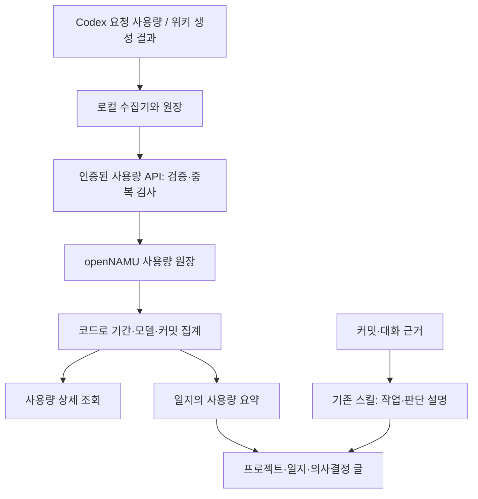

# 사용량 수집 검토와 위키 저장 설계

검토일: 2026-10-29. 상태: **설계 제안**. 중앙 원장·새 화면·새 테이블은 아직 구현하지 않았다.

## 결론

**위키를 프로젝트 기록의 보관처로 삼되, 설명 글과 계산용 원장을 분리한다.** 같은 openNAMU 서비스에서 글·커밋·사용량을 연결한다. 사람이 읽는 본문을 다시 분석해서 숫자를 복원하지 않는다.

프로젝트 개요는 무엇을 왜 만드는지 설명한다. 일지는 그날의 작업과 판단을 설명한다. 중요한 의사결정은 독립된 글로 연결한다. 사용량 원장은 요청별 수치와 출처를 보관하고, 필요한 요약만 글에 표시한다. 전체 대화와 추론 내용은 원장에 넣지 않는다.

## 현재 구현을 다시 확인한 결과

검토 대상: `scripts/wiki_usage.py`, `scripts/project_wiki.py`, `scripts/devlog_wiki.py`, `scripts/backup_local.py`, `route/api_personal_mcp.go`, `route/api_edit_post.go`, `route/api_w_set.go`, 관련 테스트와 기록 철학.

| 항목 | 현재 동작과 판단 |
| --- | --- |
| 수집·집계 | 요청 ID 중복 제거, 캐시·추론의 중복 합산 방지, 불명확한 귀속 분리. 계산에는 추가 모델 호출이 없다. 유지한다. |
| 본문 보호 | 사용량 전용 문단을 실행기가 작성한다. 기존 리비전·사람 수정 검사를 재사용한다. 유지한다. |
| 원본 위치 | Git 관리 폴더의 `devlog-wiki/usage/`에 숫자 원장을 둔다. 위키에는 파생 요약만 있다. |
| 백업 | `backup_local.py`는 DB·설정·이미지·Git bundle을 저장하지만 `devlog-wiki` 상태 폴더는 복사하지 않는다. 일반 백업이나 GitHub 푸시만으로 원장이 보존되지는 않는다. |
| 여러 PC | 로컬 원장끼리 병합하지 않는다. 같은 요청의 여러 PC 사본을 중앙에서 한 번만 세는 기능이 필요하다. 현재 MCP도 loopback 전용이어서 원격 수집은 별도 연결 설계가 필요하다. |
| 생성 호출 | 호출 ID와 사용량 수집 여부는 있다. 성공·실패·미리보기·재생성의 명시적 구분은 없다. 사용량 미수집을 생성 실패로 해석하면 안 된다. |
| 여러 세션 | 하나의 커밋에 연결한 여러 세션에 같은 시작 경계를 적용한다. 세션별 이전 커밋 시각이 다르면 유효한 요청이 귀속 미확인으로 남을 수 있다. 중앙화 전에 보완한다. |
| 과거 갱신 | 늦게 수집된 요청은 이전 커밋에 연결될 수 있다. 자동 저장은 현재 일지에 한정되므로 과거 일지는 명시적 갱신이 필요하다. |
| 집계 범위 | 보고서의 project는 해당 로컬 원장 전체다. 일·월 합계는 발생 시각, 일지는 커밋 연결 날짜를 사용한다. 서로 다른 기준의 합계를 섞지 않는다. |

기존 Python 테스트 **43개는 통과**했다. 별도 합성 자료로 여러 세션 경계 문제도 재현했다. A 세션의 이전 경계가 180, B가 120, 현재 커밋이 200일 때 시작 130·완료 150인 B 요청에 공통 경계 180이 적용됐다. 수치 120토큰은 원장에 남지만 현재 커밋에 연결되지 않았다. 기존 테스트 통과가 이 경우의 정확성을 보장하지는 않는다.

이번 검토에서는 실행기 동작을 변경하지 않았다. 이 재현 사례는 세션별 경계를 수정할 때 정식 회귀 테스트로 옮긴다.

## 어디에서 무엇을 읽게 할 것인가

| 위치 | 보여줄 내용 | 갱신 기준 |
| --- | --- | --- |
| `프로젝트/개인 개발 위키` | 소개·목적·현재 구조·최근 작업, 사용량 상세 링크 | 설명이 바뀐 경우만 본문 수정 |
| `개발 기록/날짜/개인 개발 위키` | 무엇·왜·결과, 해당 커밋에 연결한 개발/위키 작성 사용량 요약 | 해당 날짜의 변경분 |
| `의사결정/개인 개발 위키/선택 주제` | 문제·대안·선택 이유·결과, 관련 일지와 커밋 | 중요한 선택과 변경 시점 |
| `프로젝트/개인 개발 위키/AI 사용량` **(제안)** | 기간·모델·용도별 합계, 월별 보기, 수집 범위와 미확인 내역 | 숫자 원장에서 모델 없이 산출 |
| 사용량 상세 조회 **(제안)** | 요청/생성 호출 → 커밋 → 일지 연결, 원본 수치와 귀속 근거 | 원장 조회 |

월마다 문서와 메뉴를 자동으로 만들 필요는 없다. 처음에는 사용량 상세 한 곳에서 월별 표와 접힌 커밋 내역을 보여준다. 길이·읽기 속도·탐색의 실제 문제가 확인되면 분리한다. 원본 요청마다 위키 문서를 만들지 않는다.

개발 기록과 의사결정은 계속 사람이 읽는 글로 유지한다. 제목이나 목차를 데이터 필드에 맞춰 획일화하지 않는다. 변경되지 않은 소개글에 매 커밋의 수치를 다시 쓰지 않는다.

## 저장 방안 비교

| 방안 | 장점 | 한계 | 판단 |
| --- | --- | --- | --- |
| 로컬 JSON 원장 + 위키 요약 | 기존 구현 사용, 엔진 수정이 적다 | PC별 분산, 별도 백업·병합 필요 | 당장 유지 |
| 일반 위키 문서에 JSON 원장 저장 | 기존 문서 API·이력·ACL 재사용 | 전체 원문 교체, 일반 편집·되돌리기로 수치 변경 가능, 검증·집계·동시 갱신 기능은 추가 필요 | 소량의 내보내기 자료용 후보 |
| openNAMU DB의 전용 사용량 저장 + API | 요청 중복 검사와 일관된 집계, DB 백업과 함께 보존 | 스키마·권한·동시 저장·업데이트 호환 구현 필요 | 장기 방향으로 권장 |

기존 `data_set`은 문서 설정 용도이고 쓰기 API에 허용 키와 권한이 있다. 이를 임의 원장으로 쓰거나 허용 목록을 우회하지 않는다. 일반 `wiki_save`도 편집 치환·필터·길이 제한과 문서 이력을 거친다. 임의 JSON을 넣는 것만으로 수치 원장의 불변성이나 검색 기능이 생기지는 않는다.

## 중앙 원장의 최소 데이터 계약 — 제안

원본 수치와 귀속 판단을 분리한다. 늦게 온 요청 때문에 커밋 연결이 달라져도 원본 수치를 다시 만들지 않는다.

| 레코드 | 필수 의미 |
| --- | --- |
| 사용량 이벤트 | 제공자·원본 요청 ID·프로젝트 ID·세션/turn ID·발생 시각·모델·용도·수치·수치의 단위(요청/CLI 요약) |
| 커밋 구간 | 프로젝트 ID·전체 커밋 SHA·세션별 시작/종료 경계·커밋 날짜·경계 근거 |
| 생성 호출 | 고유 호출 ID·대상 커밋/수동 기록 ID·미리보기/저장 계획·실행 결과·사용량 수집 여부 |
| 수집 확인 | 대상 출처·확인 시각·지원 형식·누락/충돌 사유. 로그 원문은 제외 |

문서 제목은 바뀔 수 있으므로 안정적인 `project_id`를 사용하고 현재 제목을 별도로 대응시킨다. 커밋은 순번 대신 전체 SHA로 식별한다. 요청은 제공자와 원본 ID로 식별한다. 여러 PC에서 같은 요청을 보내도 한 번만 센다. PC 이름이나 수집 날짜를 요청 ID에 추가해서 중복을 만들지 않는다.

단일 요청이 여러 프로젝트에 제출되면 프로젝트별로 복제해서 합산하지 않는다. 소속 충돌로 남기고 집계 정책을 확인한다. 같은 ID에 다른 수치가 오면 덮어쓰지 않고 충돌로 기록한다. 불명확한 귀속은 임의 배분하지 않는다.

물리 저장은 **사용량에 한정한 작은 전용 테이블과 검증된 JSON payload**부터 검토한다. 개념별 테이블 여러 개, 모든 지식을 담는 범용 데이터베이스, 별도 벡터 DB를 먼저 만들지 않는다. 실제 컬럼·고유성 보장·인덱스·권한 설계는 구현 전에 확정한다. 저장 자료형은 저장소 규칙에 따라 SQLite `TEXT`, MySQL `LONGTEXT`를 사용하고 숫자·시각의 유효성은 API에서 검사한다. 특정 DB의 JSON 함수에 의존하지 않는다.

## 수집부터 읽기까지 — 제안

로컬에 먼저 저장하고 중앙 저장의 성공 확인 뒤 동기화 상태를 기록한다. 응답이 끊겨도 동일 ID로 재전송할 수 있어야 한다. 서버가 꺼져 있으면 로컬 자료를 유지하고 기존 재시도 경로로 다시 보낸다. 최초 버전에는 별도 상주 서비스나 메시지 큐를 추가하지 않는다.

사용량 API는 인증과 프로젝트별 조회/쓰기 권한을 직접 확인한다. View는 조회 결과만 표시한다. 서버 원장을 기준으로 집계하고, 한 PC의 부분 합계로 중앙 합계를 덮어쓰지 않는다. 여러 PC 연결은 기존 loopback 제한을 단순 해제하는 방식으로 구현하지 않는다.

과거 수치가 보완되면 영향받은 날짜만 갱신한다. 사용량 조회는 새 원장을 읽고, 일지 요약에는 집계 기준과 갱신 시점을 남긴다. 사람의 사용량 문단 수정으로 자동 반영이 보류되면 최신 조회와 저장된 요약이 다를 수 있음을 표시한다.

## 비용과 복구 기준

- 새 요청을 숫자로 읽고 검증·집계·저장하는 데 모델을 호출하지 않는다.
- 설명을 쓰는 기존 모델에는 관련 작업 근거만 준다. 전체 숫자 원장과 월별 표를 매번 넣지 않는다.
- 같은 내용은 다시 저장하지 않는다. 수치만 바뀌면 사용량 부분만 갱신한다.
- 구독 한도와 청구액은 토큰 합계와 별개다. 검증된 단가 없이 비용으로 환산하지 않는다.
- 원장에는 형식 버전을 두고 비공개 JSON 내보내기/재가져오기를 검증한다. 재가져오기도 같은 ID 중복 검사를 적용한다.
- 위키 DB에는 성공적으로 동기화한 원장이 포함된다. 아직 동기화하지 못한 로컬 원장·대기 상태와 자동 편집 기준은 별도 백업한다. 전체 대화는 다른 보존 대상이다.

## 구현 순서와 완료 기준

1. **현재 실행기의 정확성과 복구부터 보완한다.** 세션별 경계, 생성 호출 상태, 실제 백업 범위를 수정한다. 기존 원장은 보존한다. 경계가 다른 두 세션, 누락 로그, 생성 실패, 복구 후 같은 요청의 재수집을 검증한다.
2. **중앙 저장을 작은 단위로 추가한다.** 구체적인 스키마와 권한 설계를 승인받은 뒤 API·원장·동기화부터 구현한다. 여러 PC 중복 제출, 같은 ID 수치 충돌, 응답 유실 후 재시도, 권한 거부, SQLite/MySQL 호환을 검사한다.
3. **읽는 곳을 연결한다.** 프로젝트에서 사용량 상세로, 일지에서 관련 커밋으로 이어지게 한다. 자정 경계, 늦은 요청, 과거 정정, 사람 수정 보존, 백업 복원을 검증한다.

현재는 1단계의 **검토**까지 완료했다. 신규 테이블은 `AGENTS.md`의 데이터 보존 원칙에 따라 아직 만들지 않았다. 실측 없이 캐시·사전 집계 테이블·별도 화면을 늘리지 않는다.
